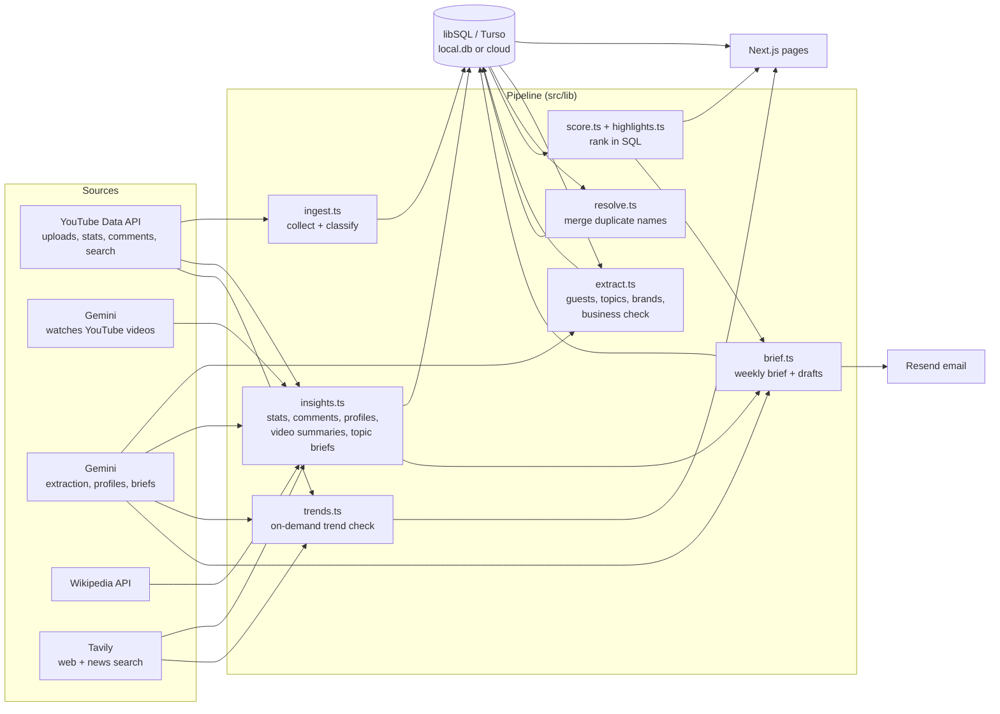

# Podcast Radar: Component Map

How the app is put together and how data flows from YouTube to the founder's screen and inbox. It also covers the method used to build it, so the same approach can map (or rebuild) another project.

- **Product truth:** `PRODUCT.md`
- **Visual system:** `DESIGN.md`
- **Original build spec:** `PODCAST_RADAR_SPEC.md`

---

## 1. The approach (repeatable workflow)

These are the steps this project followed. Each one produces something the next step depends on.

| # | Step | What we did here | Output |
|---|------|------------------|--------|
| 1 | **Isolate** | Cloned the original repo into a new folder and removed the `origin` remote, so no change can reach the base project. Copied `.env.local` and `local.db` (both git-ignored). | `podcastIntelligence-dev/` with no remote |
| 2 | **Run the baseline** | Installed, migrated the copied DB, started on port 3001 next to the original's 3000. | A working app to compare against |
| 3 | **Clarify before building** | Asked only decisions that change the work: data source, guest research source, video depth, ranking metric, what "remove" means, light/dark, layout fidelity. | Confirmed requirements |
| 4 | **Data first** | Confirmed the 10 YouTube channel IDs with the user, collected 60 days of uploads, filtered clips, extracted with Gemini. | Real rows in the DB |
| 5 | **Pipeline, then screens** | Added each stage as a library module with a script and a job route, then built pages that read only from the DB. | `src/lib/*`, `scripts/*`, `src/app/api/jobs/*` |
| 6 | **Verify with real runs** | Ran every stage end to end, including a trial email, then checked every page at 375 / 768 / 1440 px for overflow and errors. | Pass/fail table, screenshots |
| 7 | **Design pass** | Restyled to a pinned reference (YouTube-style). An independent reviewer compared captures with the reference, then fix rounds followed. | `DESIGN.md`, tokens in `globals.css` |
| 8 | **Ship prep** | Tests, typecheck, lint, production build, secret scan, cloud DB (Turso) seeded from the local data. | Ready to push to a **new** repo |

Rules that held throughout:
- Real data only.
- Every AI claim is checked against its source text.
- Outreach is drafted, never sent.
- API quotas are capped per run.

---

## 2. System overview

---

## 3. Pipeline stages

| Stage | Module | Run it | Reads | Writes | External / cost |
|-------|--------|--------|-------|--------|-----------------|
| 1. Collect | `lib/ingest.ts` → `ingestAll`, `ingestShow` | Runs page · `npm run backfill -- --ingest-only` · `GET /api/jobs/ingest` · auto when a channel is added | `shows` | `episodes` (kind: full / clip / trailer / live), `ingest_runs` | YouTube `playlistItems` + `videos` (1 unit per 50) |
| 2. Extract | `lib/extract.ts` → `extractBatch` | Runs page · `npm run extract` · `/api/jobs/extract` | pending full `episodes` | `guests`, `brands`, `appearances`, `brand_mentions`, `episode_topics`, `episodes.business_related`, `extract_runs` | Gemini, 1 call per episode, capped per run. Evidence guard in `lib/evidence.ts` drops anything not quoted from the text |
| 3. Merge names | `lib/resolve.ts` → `resolveEntities` | Runs page · `npm run report:score -- --resolve` · `/api/jobs/score` | `guests`, `brands` | `entity_aliases`, `entity_decisions`, `resolve_runs` | Levenshtein; Gemini only for borderline pairs |
| 4. Score | `lib/score.ts` → `computeScores`; `lib/highlights.ts` → `computeHighlights`, `weekStats` | On every page load (pure SQL) | extracted business episodes on active channels | nothing | none |
| 5. Stats + research | `lib/insights.ts` → `runInsights` | Runs page · `npm run insights` · `/api/jobs/insights` | top guests and topics | `episodes.view/like/comment_count`, `video_comments`, `insights`, `insight_runs` | YouTube stats + comments (1 unit each), search (100 units/guest); Gemini text + video; Wikipedia; Tavily |
| 5b. Watch all videos | `scripts/analyse-videos.ts` → `analyseEpisode` | `npm run analyse` | business episodes without a summary | `insights` (episode / analysis) | Gemini video, first 40 min, about 220K tokens each |
| 6. Trend check | `lib/trends.ts` → `checkTrend` | Topics tab search box or chips | YouTube, `episodes` | `insights` (topic / trend, 6 h cache) | YouTube search ×2 (≈200 units); Tavily news; Gemini |
| 7. Brief + email | `lib/brief.ts` → `buildBrief`, `emailBrief` | Overview button · Runs page · `npm run brief` · `/api/jobs/brief` | rankings + `insights` | `briefs`, `pipeline` (drafts) | Gemini, 1 call; Resend, 1 email |

Job routes need `Authorization: Bearer $CRON_SECRET` (`lib/auth.ts`). Long-running work stops at a deadline and a per-run Gemini cap; the next run picks up where it stopped.

---

## 4. Data model (`db/migrations`)

| Group | Tables | Notes |
|-------|--------|-------|
| Sources | `shows`, `episodes` | `shows.active = 0` means removed: history kept, hidden from rankings |
| Extracted facts | `guests`, `brands`, `topics`, `appearances`, `brand_mentions`, `episode_topics` | Each fact stores the `evidence` quote it came from |
| Identity | `entity_aliases`, `entity_decisions` | A merged name points at the kept one; every decision is logged |
| YouTube signals | `episodes.view_count/like_count/comment_count`, `video_comments` | Refreshed by stage 5 |
| AI outputs | `insights` (`entity_type`, `entity_id`, `kind`, `payload`, `sources`, `error`) | Kinds: guest/profile, guest/youtube, episode/analysis, episode/comments, topic/brief, topic/trend |
| Outputs | `briefs`, `pipeline` | Drafts stay `suggested` until the founder moves them |
| Run logs | `ingest_runs`, `extract_runs`, `resolve_runs`, `insight_runs` | Feed the Runs page and Recent activity |
| Config | `scoring_config` | Weights, caps and windows, editable without code changes |

Migrations run with `npm run db:migrate` and are tracked in `_migrations`.

---

## 5. Library modules (`src/lib`)

| Module | Responsibility | Key exports |
|--------|----------------|-------------|
| `db-core.ts`, `db.ts` | Lazy libSQL client from `TURSO_DATABASE_URL` | `db` |
| `youtube.ts` | Every YouTube Data API call | `resolveChannelInput`, `listUploads`, `getVideos`, `getVideoStats`, `getTopComments`, `searchVideos`, `searchVideosWindow` |
| `gemini.ts` | Gemini calls with one shared retry/backoff and quota handling | `generateJson`, `generateFromVideo`, `generateGrounded`, `RateLimitError` |
| `websearch.ts` | Web documents for grounding when Google grounding isn't available | `wikipediaPerson`, `tavilySearch`, `docsPrompt` |
| `classify.ts`, `duration.ts`, `match.ts` | Clip/trailer detection, duration parsing, cross-source episode matching | `classifyKind`, `isSameEpisode` |
| `evidence.ts` | Hallucination guard: every guest and brand must quote the source | `verifyExtraction`, `evidenceFound` |
| `ingest.ts` → `extract.ts` → `resolve.ts` | Pipeline stages 1–3 | see §3 |
| `entities.ts`, `score.ts` | Pure scoring helpers and SQL rankings | `computeScores`, `topicTrend`, `sponsorScore` |
| `highlights.ts` | Founder view: ranked lists with one-line reasons, top episodes, week-over-week, activity | `computeHighlights`, `weekStats`, `recentActivity` |
| `insights.ts` | Stats, comments, guest profiles, video summaries, topic briefs | `runInsights`, `readInsight`, `analyseEpisode`, `generateGuestProfile`, `generateTopicBrief` |
| `trends.ts` | "Is it trending?" check | `checkTrend`, `trendVerdict`, `TREND_PRESETS` |
| `brief.ts` | Weekly brief, outreach drafts, HTML/text email | `buildBrief`, `renderBriefEmail`, `emailBrief` |
| `podcastindex.ts`, `spotify.ts` | Optional RSS / Spotify lookups (Shows admin) | `searchFeeds`, `searchShows` |
| `auth.ts` | Job-route protection | `checkCronAuth` |

---

## 6. Routes and screens (`src/app`)

| Route | Purpose | Built from | Data | Actions |
|-------|---------|-----------|------|---------|
| `/` Overview | Greeting, 4 week-over-week tiles, top 5 guests / topics / sponsors, highlights, weekly brief, top 3 episodes, channel manager | `Stat`, `RankCard` + `GuestRow` / `TopicRow` / `SponsorRow`, `Rail`, `ChannelManager`, `ActionButton` | `computeHighlights`, `weekStats`, `recentActivity`, `readInsight` | `writeAndSendBrief`, `findChannel` / `addChannel` / `removeChannel` / `restoreChannel` |
| `/rankings?tab=guests\|topics\|sponsors` | Full ranked lists; Topics tab has the trend search | tabs, `TrendSearch`, `Merges` | `computeHighlights` | `runTrendCheck` |
| `/guests/[id]` | How to approach, what they said (timestamped), profile, news, episodes, other YouTube videos, sources | `ActionButton`, `Panel`, `Pill` | `readInsight` (profile, youtube, analysis) | `researchGuest` |
| `/topics/[slug]` | Questions covered, what viewers ask, key points, open angles, episodes | `ActionButton` | `readInsight` (brief), episodes | `writeTopicBrief` |
| `/episodes`, `/episodes/[id]` | All collected items; episode detail with video summary, business check, extracted facts and evidence | `SourceIcons`, `VideoSummary` | episodes, insights | — |
| `/pipeline` (Outreach) | Draft emails per guest and brand | `CopyButton` | `pipeline` | — |
| `/search?q=` | Guests, topics, brands, episodes, channels | — | SQL `LIKE` | — |
| `/admin/shows` (Channels) | Resolve and confirm channel / RSS / Spotify IDs, hosts | `admin/shows/actions.ts` | `shows` | `confirmYoutube`, `toggleActive`, … |
| `/admin/runs` | Run each stage by hand; run history | `SubmitButton`, `ActionButton` | run logs | ingest, extract, score, research, brief |
| `/api/jobs/{ingest,extract,score,insights,brief}` | Scheduled / manual stage triggers | — | — | — |

Server actions:
- `channel-actions.ts`: find, add, remove and restore a channel.
- `research-actions.ts`: guest research, topic brief, trend check, brief + email.
- `admin/shows/actions.ts`

---

## 7. Shared UI (`src/components`)

| Component | File | Used for |
|-----------|------|----------|
| `Nav` (side mini-guide / mobile chips) | `nav.tsx` | Main navigation; active state reads `pathname` and `?tab` |
| `ThemeToggle` | `theme-toggle.tsx` | Light (default) and YouTube dark; stored in `localStorage`, set before paint |
| `PageHeader`, `Section`, `Panel`, `Pill`, `EmptyState`, `TextLink`, `PageSkeleton`, `ShowName`, `StatusPill`, `btn`, `input` | `ui.tsx` | Page scaffolding and tokens-in-classes |
| `fmtDate`, `fmtDateTime`, `ago`, `duration`, `n`, `showColor` | `ui.tsx` | Formatting (IST) and the per-channel colour |
| `SubmitButton`, `ActionButton`, `CopyButton`, `AutoSelect` | `client.tsx` | Form actions with pending and error states, clipboard |
| `ChannelManager` | `channel-manager.tsx` | Search → preview → add; remove / track again |
| `TrendSearch` | `trend-search.tsx` | Search box + 30 business chips → trend result card |

The look and its rules (one red, five tints, Roboto, pill buttons, two-line rows, named dots) are in `DESIGN.md`.

---

## 8. Configuration

| Variable | Used by | Notes |
|----------|---------|-------|
| `TURSO_DATABASE_URL`, `TURSO_AUTH_TOKEN` | `db-core.ts` | Local: `file:local.db`. Deployed: the Turso URL and token |
| `TURSO_CLOUD_DATABASE_URL`, `TURSO_CLOUD_AUTH_TOKEN` | deploy | Cloud DB `podcast-radar` (Mumbai), seeded from local data |
| `TURSO_API_TOKEN` | setup only | Turso Platform API; not needed at runtime |
| `GEMINI_API_KEY`, `GEMINI_MODEL` | `gemini.ts` | Currently `gemini-3.5-flash-lite` (free tier: per-minute limits) |
| `GEMINI_SEARCH_GROUNDING` | `websearch.ts` | `true` only with a billing-enabled key |
| `YOUTUBE_API_KEY` | `youtube.ts` | 10,000 units/day |
| `TAVILY_API_KEY` | `websearch.ts` | Guest web research + trend news |
| `RESEND_API_KEY`, `BRIEF_RECIPIENT_EMAIL`, `BRIEF_FROM_EMAIL`, `APP_URL` | `brief.ts` | Test mode delivers only to the Resend account owner |
| `PODCASTINDEX_*`, `SPOTIFY_*` | Shows admin | Optional |
| `CRON_SECRET` | `auth.ts` | Protects `/api/jobs/*` |

All values live in `.env.local`, which git ignores. `.env.example` lists the names.

---

## 9. Guardrails built into the components

- **Evidence check.** Extraction keeps a guest or brand only if its quote appears in the episode text. Topic briefs keep a viewer question only if its quote is in the comments.
- **Business filter.** Non-business episodes aren't watched, ranked or counted. Each one stores why it was filtered.
- **Clip filter.** Under 15 minutes or `#shorts` means a clip, which never counts as an appearance.
- **Numbers come from SQL.** Gemini writes prose, summaries and drafts; it never computes a ranking or a count.
- **Caps and deadlines.** Every run has them; a daily-quota error stops the run cleanly.
- **Outreach is never sent.** Drafts only; the brief goes only to the founder.
- **Removed channels** keep their history and drop out of rankings.

---

## 10. Verification checklist

Run before pushing:
1. `npm test` (56 tests)
2. `npx tsc --noEmit`
3. `npx eslint src scripts`
4. `npm run build`
5. Stage run: collect → extract → merge → research → rankings → channel lookup → trend check → brief + email.
6. Every route at 375, 768 and 1440 px: no horizontal overflow, no page errors, 200 status.
7. Secret scan of tracked files. `.env.local` and `local.db` must be ignored.
8. `git remote -v` points at the **new** repository, never the original.

---

## 11. How to make a component map like this for another project

1. **Inventory.** List every route, component, library module, script, job route and migration, with its exports. A one-line shell loop over `src` is enough (see §5–§7 for the shape).
2. **Find the spine.** Trace one real record from its source to the screen. Here: a YouTube upload becomes an `episodes` row, then an extraction, then a ranking, then a card on `/`. That path becomes the pipeline table (§3).
3. **Group by layer.** Use sources → pipeline modules → storage → read models → routes → shared UI. Each module belongs to exactly one layer.
4. **For each stage, record five things:** what runs it, what it reads, what it writes, which external service it calls, and what it costs or caps.
5. **Map storage by purpose,** not alphabetically: sources, facts, identity, signals, AI outputs, outputs, logs, config.
6. **For each route, record** what the user does there, the components it uses, the data functions it calls, and the actions it can trigger.
7. **List configuration by name only.** Never paste values.
8. **Write down the guardrails.** They explain why components are shaped the way they are.
9. **Add the verification checklist,** so the map doubles as a release gate.
10. **Draw one diagram.** One overview (§2) beats many partial ones. Keep it in Mermaid so it lives next to the code and diffs cleanly.
